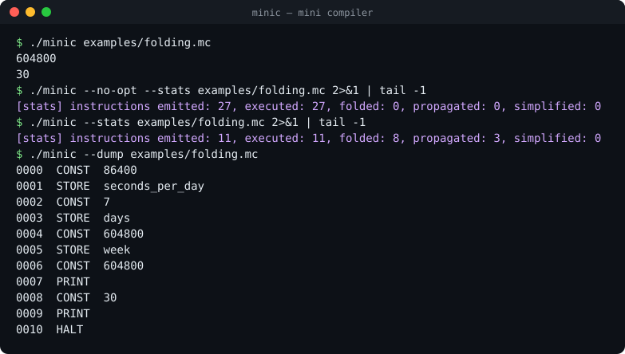

# minic: a small compiler and bytecode VM in C++

`minic` compiles a tiny expression language to stack-machine bytecode and runs it on its own virtual machine. It covers the full compiler pipeline: **lexing → parsing → AST → optimization → code generation → execution**.

```
let seconds_per_day = 60 * 60 * 24;
let week = seconds_per_day * 7;
print week;   # 604800
```



## Pipeline

| Stage | File | What it does |
| --- | --- | --- |
| Lexer | `src/lexer.cpp` | Turns source text into tokens (numbers, names, operators, `let`, `print`) and skips `#` comments |
| Parser | `src/parser.cpp` | Recursive-descent parser that builds an AST with correct precedence (`* / %` before `+ -`, unary minus) |
| Optimizer | `src/optimizer.cpp` | Constant propagation, constant folding and algebraic simplification (`x*1`, `x+0`, ...) |
| Code generator | `src/codegen.cpp` | Emits stack bytecode, deduplicates constants, assigns variable slots, catches use-before-definition |
| VM | `src/vm.cpp` | Executes the bytecode on a value stack and reports runtime errors such as division by zero |

## Grammar

```
program := stmt*
stmt    := 'let' IDENT '=' expr ';' | 'print' expr ';'
expr    := term (('+' | '-') term)*
term    := unary (('*' | '/' | '%') unary)*
unary   := '-' unary | primary
primary := NUMBER | IDENT | '(' expr ')'
```

## Build and run

Requires a C++17 compiler and `make`.

```bash
make
./minic examples/basics.mc          # run a program
./minic --dump examples/folding.mc  # show the generated bytecode
./minic --ast examples/runtime.mc   # show the optimized AST
./minic --no-opt --dump examples/folding.mc   # compare with the optimizer off
./minic --stats examples/folding.mc # instruction counts and optimizer stats
make test                           # run the test suite
```

## What the optimizer does

`examples/folding.mc` compiles to **27 instructions without the optimizer and 11 with it** (59% fewer), because every value is known at compile time:

```
$ ./minic --dump examples/folding.mc
0000  CONST  86400
0001  STORE  seconds_per_day
0002  CONST  7
0003  STORE  days
0004  CONST  604800
0005  STORE  week
0006  CONST  604800
0007  PRINT
0008  CONST  30
0009  PRINT
0010  HALT
```

- **Constant folding:** `60 * 60 * 24` becomes `86400` at compile time.
- **Constant propagation:** once `days` is known to be `7`, later reads of `days` are replaced by `7`, which lets more expressions fold.
- **Algebraic simplification:** `x * 1`, `x / 1`, `x + 0`, `0 + x` and `x - 0` become `x`.
- Division by zero is never folded, so it is still reported as a runtime error with its line number.

## Tests

`tests/run_tests.sh` runs every example with the optimizer on and off and checks that the output is identical, plus tests for syntax errors, undefined variables, division by zero and constant propagation.

```
$ make test
PASS  basics (opt)
...
10 passed, 0 failed
```

## Next steps

- `if` / `while` with jump instructions
- A register-based VM to compare against the stack VM
- An LLVM backend (see my [Kaleidoscope project](https://github.com/omar9ll/kaleidoscope-llvm))
